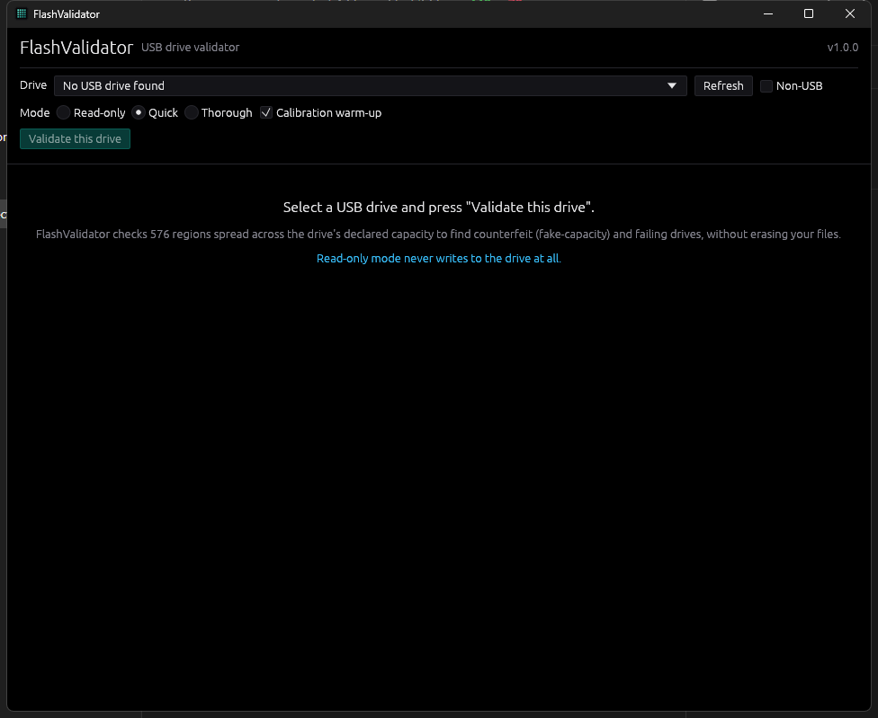

<p align="center">
  
</p>

<h1 align="center">FlashValidator</h1>

<p align="center"><b>Find counterfeit and failing USB drives in minutes, without losing your data.</b><br>
Linux and Windows · desktop app and command line</p>

---

Counterfeit USB drives report a capacity they don't have: a "2 TB" stick may
really store 32 GB, and files written past that point are silently lost.
FlashValidator checks **576 regions spread evenly across the whole declared
capacity** and puts your data back afterwards. A full write-and-verify pass
takes hours; this takes minutes.



## Test modes

| Mode | Writes to the drive? | Finds | Proves the capacity? |
|---|---|---|---|
| **Read-only** | **Never.** The drive is opened read-only, so the OS itself rejects writes. | Read errors, unstable reads (data that changes between two reads), address wrap-around visible in existing data | No |
| **Quick** (default) | Yes. Each region is saved, written, verified and restored. | Missing storage (writes that don't stick), read and write errors | Yes, except for wrap-around fakes |
| **Thorough** | Yes. All regions plus power-of-two probes are written, then verified, then restored. | Everything Quick finds, plus wrap-around fakes, with the wrap period | Yes |

**Read-only mode carries no risk to your data**, but it is a weaker test. A
drive that silently drops writes and returns zeros looks exactly like an empty
drive when you only read it. FlashValidator says so in the report ("the
capacity is not proven") and tells you where the blank area starts.

The writing modes are built to keep your data:

- I/O bypasses the OS cache (`O_DIRECT|O_SYNC` on Linux, `FILE_FLAG_NO_BUFFERING|WRITE_THROUGH` on Windows), so every read-back really comes from the drive.
- Each original block is saved in a **crash-recovery journal** on the computer *before* the drive is touched.
- `flashvalidator restore` puts the data back if the program crashes or the drive is pulled out.

## Installation

Download the archive for your system from the releases page.

### Linux

```bash
tar -xzf flashvalidator-v1.0.0-linux-x86_64.tar.gz
```

```bash
cd flashvalidator-v1.0.0-linux-x86_64
```

```bash
sudo ./install.sh
```

This installs `flashvalidator` and `flashvalidator-gui` into `/usr/local/bin`,
plus a menu entry and an icon. `sudo ./install.sh --uninstall` removes them.
The permission prompt in the desktop app uses `pkexec` (polkit), which desktop
distributions include by default.

### Windows

Extract `flashvalidator-v1.0.0-windows-x86_64.zip` and run
`flashvalidator-gui.exe`. No installation is needed.

## Permissions

You don't need to start FlashValidator as root or as administrator. When a
test starts and raw drive access is needed, it asks:

| | Desktop app | Command line |
|---|---|---|
| Linux | polkit password dialog (`pkexec`) | `sudo` in the same terminal |
| Windows | UAC prompt | UAC prompt; the test continues in an elevated console window |

The desktop app keeps running as your user. Only a small helper process (the
same executable started in helper mode) gets elevated rights. It talks to the
window over a token-authenticated local connection. On Linux, members of the
`disk` group (and root) are not asked.

## Usage

### Desktop app

Open **FlashValidator**, choose the drive and a mode, then press **Validate
this drive**.

### Command line

```bash
flashvalidator list
```

```bash
flashvalidator test /dev/sdb --mode read-only
```

```bash
flashvalidator test /dev/sdb
```

```bash
flashvalidator test 2 --mode thorough --save-json report.json
```

On Windows, drives are named `\\.\PhysicalDrive2`, or just `2`.

Notes:

- On Linux, the writing modes need the drive's partitions unmounted, for
  example `udisksctl unmount -b /dev/sdb1`. Read-only mode works while they
  are mounted.
- On Windows, the writing modes lock and dismount the drive's volumes and take
  the disk offline (not persistent) during the test. The disk comes back online
  automatically.
- Only USB drives are accepted unless you pass `--allow-non-usb` (command
  line) or tick "Non-USB" (desktop app). Never run a writing test on a system
  disk.

### Recovering from an interrupted run

If a writing test is interrupted, the journal is kept and its path is shown:

```bash
flashvalidator restore /root/.local/state/flashvalidator/flashvalidator-1763571234-4242.fvj /dev/sdb
```

Journals are stored in `$XDG_STATE_HOME/flashvalidator` (Linux, for the
elevated user) or `%LOCALAPPDATA%\FlashValidator\journals` (Windows). They are
deleted automatically after a clean run.

### Exit codes (`flashvalidator test`)

| Code | Meaning |
|---|---|
| 0 | Drive passed (or read-only mode found no problem) |
| 1 | The test could not run (permissions, busy, write-protected, ...) |
| 2 | Drive failed: counterfeit capacity, no valid storage, or I/O errors |
| 3 | Test incomplete (stopped by the user or drive removed) |

## Understanding the results

| Map colour / symbol | Meaning |
|---|---|
| green `.` | Validated: data was stored and read back intact |
| blue `o` | Readable (read-only mode): consistent reads, storage not proven |
| red `X` | No storage: the data did not stick, reads are unstable, or the region aliases another one |
| amber `R` | Read error |
| purple `W` | Write error (including a failed restore) |
| grey `?` | Not tested |

- **Validated size** (or **readable size** in read-only mode) is where the run
  of good regions that starts at region 0 ends. For a counterfeit drive this is
  roughly its real capacity.
- **Highest good region** is the last good region anywhere on the drive.
- The **performance** table shows read and write latency (minimum, maximum,
  average, median, standard deviation) and throughput.

## Limitations

- It is a *spot-check*: it samples 576 places (plus probes), not every block.
  Use a full write-and-verify tool for an exhaustive test.
- Quick mode cannot detect drives that wrap addresses. Use Thorough mode if in
  doubt.
- Wrap detection finds periods of 2^k or 3·2^k. These are what
  address-masking controllers produce.
- Writing modes write to the drive. FlashValidator works hard to restore
  everything, but a dying drive can fail at any time. Back up important data
  first, or use read-only mode.

## Building from source

You need Rust 1.85 or newer.

```bash
cargo build --release
```

This builds `target/release/flashvalidator` and `target/release/flashvalidator-gui`.

On Debian/Ubuntu, the desktop app needs these development packages:

```bash
sudo apt install libxkbcommon-dev libwayland-dev libgl1-mesa-dev libx11-dev libxcursor-dev libxrandr-dev libxi-dev
```

### Development

```bash
cargo fmt --all
```

```bash
cargo clippy --workspace --all-targets -- -D warnings
```

```bash
cargo test --workspace
```

The engine tests run against in-memory simulated drives (genuine, discarding,
wrapping, unstable, failing). They check that writing modes leave the drive's
contents byte-for-byte unchanged and that read-only mode issues no writes at
all. An integration test runs the real helper binary to check the elevation
protocol. To publish a release, push a `v*` tag; the release workflow builds
and uploads the Linux and Windows archives.

### Project layout

```
crates/
  flashvalidator-core/   library: drives, raw I/O, engine, journal, privilege, reports
  flashvalidator-cli/    `flashvalidator` command-line tool
  flashvalidator-gui/    `flashvalidator-gui` desktop app (+ elevated helper mode)
assets/                  icon (SVG and procedural artwork)
packaging/linux/         .desktop entry and install script
docs/ARCHITECTURE.md     design and algorithms
```

## License

FlashValidator is dual-licensed under the [MIT](LICENSE-MIT) and
[Apache 2.0](LICENSE-APACHE) licenses, at your option.
